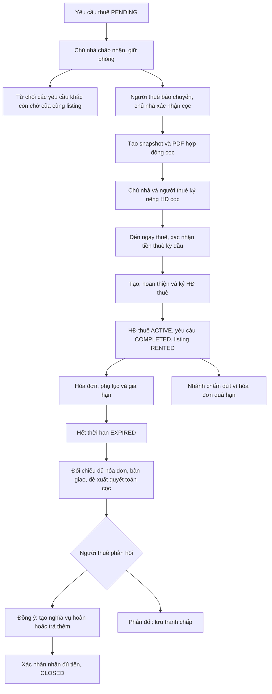

# Review vòng đời hợp đồng HomeSpace — 02/11/2026

## 1. Kết luận và phạm vi

Luồng thuận lợi đã tách hồ sơ cọc và hợp đồng thuê, ký độc lập. Tuy nhiên, chưa nên kết luận vòng đời đã kín: có lỗi đối chiếu bản nháp với dữ liệu nghiệp vụ, nhánh tranh chấp không có đường xử lý tiếp, sổ cọc thiếu số tiền khấu trừ và gia hạn không gửi lại được sau từ chối/hết hạn phản hồi.

Đợt này **chỉ review và kiểm chứng**, chưa sửa nghiệp vụ, chưa thay schema, chưa chạy seed/drop DB, chưa thực hiện giao dịch hoặc ký số thật.

Đã đọc và đối chiếu các đường thực thi chính:

- `RentalRequestService`, `RentalOnboardingService`, `OnboardingFacade` và API tương ứng.
- `PaymentRequestService`, `ContractDraftFunding`, `AutomaticContractDrafts`, `DepositAgreementService`.
- `ContractServiceImpl`, `SmartCaSignatureServiceImpl`, trạng thái/chứng từ/chữ ký và repository liên quan.
- `MonthlyBillingService`, `ContractLifecycleService`, `ContractAmendmentService`, `ContractTermsResolver`, `ContractLeaseCalc`.
- Test liên quan và tài liệu lifecycle/billing hiện có. Kiểm tra thêm trang khiếu nại admin để xác định chức năng đó đã triển khai hay chỉ có menu.

Đây là review theo code và test; không phải xác nhận mọi tình huống production hoặc đánh giá hiệu lực pháp lý của mẫu hợp đồng.

## 2. Luồng đang có

- Chuyển khoản hiện là báo chuyển/chứng từ và xác nhận của người nhận; không phải tự xác minh ngân hàng.
- HĐ cọc ký đủ không làm listing thành RENTED. HĐ thuê mới kích hoạt thuê.
- Có nhánh cọc trước, nhận nhà sau và nhánh thu lúc bắt đầu thuê. Code còn có ngoại lệ miễn cọc bằng 0: `signedOrExempt()` bỏ qua HĐ cọc, không tạo văn bản ký cọc giả. Nếu sản phẩm muốn tuyệt đối mọi hồ sơ đều có hai văn bản thì cần quyết định riêng cho ngoại lệ này.
- `ACTIVE` ở văn bản cọc biểu thị đã ký, không đồng nghĩa hợp đồng thuê đang chạy. Hiện chưa tách riêng trạng thái hoàn tất nghĩa vụ giữ chỗ của văn bản cọc.
- Hết thời hạn không tự đồng nghĩa đã bàn giao, hoàn tiền hay đóng hồ sơ.

## 3. Lỗi đã xác nhận

### F01 — P1: Bản nháp hợp đồng và lịch thuê/thanh toán có thể lệch nhau

**Code:** `ContractServiceImpl.updateRevision()` dòng 510–595; `ContractLeaseCalc.months()/end()`; `MonthlyBillingService.syncContract()` dòng 766 trở đi; `ContractServiceImpl.assessCompleteness()`.

API sửa bản nháp nhận các map `lease`, `financial`, `initialPayment` rồi lưu vào snapshot. Chưa có bước đối chiếu ngày bắt đầu, thời hạn và số tiền với `RentalRequest`/khoản đã xác nhận. Kiểm tra completeness chủ yếu kiểm tra trường bắt buộc và chỉ số, không chứng minh các nguồn dữ liệu khớp nhau.

**Đã tái hiện bằng service test tạm:** hồ sơ thuê từ 02/11/2026 trong 3 tháng, cọc 3 triệu; API lưu được snapshot bắt đầu 01/12/2026, thời hạn 12 tháng, cọc 9 triệu. `RentalRequest` vẫn là 3 tháng, còn `ContractLeaseCalc` vẫn tính kết thúc 02/02/2027. Khi xuất văn bản có thể hiển thị một bộ điều khoản trong khi lịch thu tiền, thời điểm hết hạn hoặc sổ cọc dùng bộ dữ liệu khác.

**Hướng sửa:** phân loại trường được sửa; các điều khoản ảnh hưởng lịch/tiền phải qua xác thực và cập nhật nguồn nghiệp vụ trong cùng transaction, hoặc từ chối và yêu cầu luồng điều chỉnh có thỏa thuận. Khoản đã nhận phải giữ nguyên lịch sử; nếu thay đổi số tiền thì tạo chênh lệch/hoàn bổ sung, không sửa receipt cũ. Kiểm tra lại trước xuất PDF và trước ký, không chỉ trên UI.

### F02 — P1: Tranh chấp tiền định kỳ/hoàn cọc có thể trở thành trạng thái không có lối ra

**Code:** `PaymentRequestService.dispute()` dòng 639; `reportTransfer()` dòng 417; `confirmReceipt()` dòng 534; `extendMonthlyDueDate()` dòng 907. `RentalOnboardingService.resolveReview()` dòng 337 chỉ nhận khoản onboarding.

Sau `DISPUTED`:

- Người nhận không gọi được `confirmReceipt`, vì hàm chỉ nhận `TRANSFER_REPORTED`.
- Người gửi không báo chuyển lại được, vì `reportTransfer` không nhận `DISPUTED`.
- Không mở lại bằng gia hạn tiền định kỳ được.
- API đối soát onboarding không áp dụng cho `MONTHLY_RENT`, `DEPOSIT_REFUND` hoặc khoản điều chỉnh cọc.
- Chưa có API admin xử lý tranh chấp để đưa khoản về một trạng thái hợp lệ.

**Đã tái hiện bằng service test tạm cho cả `MONTHLY_RENT` và `DEPOSIT_REFUND`:** mở dispute thành công, sau đó cả xác nhận nhận tiền và báo chuyển lại đều bị chặn. Hóa đơn/hoàn cọc không hoàn tất được bằng các API hiện có dù hai bên đã thống nhất ngoài hệ thống.

**Hướng sửa:** thêm workflow giải quyết tranh chấp có phân quyền, bằng chứng, phiên bản và lịch sử. Trạng thái giải quyết phải rõ: mở lại báo chuyển, cho người nhận xác nhận, hoặc hủy/điều chỉnh nghĩa vụ bằng hồ sơ mới. Admin không được tự xem quyết định xử lý là bằng chứng tiền đã được chuyển.

### F03 — P2: Quyết toán cuối hợp đồng chưa cập nhật đủ `deposit_records.retained_amount`

**Code:** `ContractLifecycleService.acceptClosure()` dòng 172–205; đối chiếu với `MonthlyBillingService.finalizeTermination()` và `RentalOnboardingService.completeDefault()` có gọi `setRetainedAmount()`.

Nhánh quyết toán thông thường ghi số tiền khấu trừ trong `contract_closures` nhưng chưa ghi tương ứng vào `DepositRecord.retainedAmount`.

**Đã tái hiện bằng hai service test tạm:**

- Cọc 20 triệu, khấu trừ 100 nghìn: còn giữ để hoàn 19,9 triệu nhưng `retainedAmount` vẫn null.
- Khấu trừ toàn bộ 20 triệu: trạng thái `RETAINED_BY_LANDLORD`, số đang giữ 0 nhưng `retainedAmount` vẫn null.

Số nghĩa vụ hoàn trong closure vẫn được tính đúng ở hai ca trên; lỗi nằm ở tính đầy đủ của sổ cọc, khiến báo cáo/AI/API đọc sổ cọc có thể thiếu khoản đã giữ lại.

**Hướng sửa:** ghi số tiền thực giữ lại, lý do và dấu thời gian cho cả nhánh giữ một phần/toàn bộ; kiểm tra bất biến giữa tiền đã nhận, chênh lệch đã xác nhận, tiền đang giữ, khấu trừ và hoàn thực tế. Không tính khoản khấu trừ vượt cọc thành tiền cọc đã giữ.

### F04 — P2: Từ chối hoặc hết hạn một đề nghị gia hạn có thể chặn gửi lại vĩnh viễn cho cùng kỳ

**Code:** `ContractLifecycleService.canRequest()` dòng 399–403.

Điều kiện `noneMatch(r -> end(c).equals(r.getStartsOn()))` xét mọi đề nghị cũ, không phân biệt `REJECTED`/`EXPIRED` với đề nghị đang xử lý/đã áp dụng.

**Đã tái hiện bằng hai service test tạm:**

- Bị từ chối gia hạn 3 tháng, sau đó muốn gửi lại 1 tháng trong cửa sổ còn hợp lệ: bị chặn.
- Đề nghị hết hạn phản hồi sau 48 giờ, vẫn còn nhiều ngày trước cutoff ký: gửi lại cũng bị chặn.

**Hướng sửa:** chỉ chặn bản đang xử lý hoặc đã áp dụng cho đúng kỳ; cho phép đề nghị mới khi bản cũ đã kết thúc nếu đó là chính sách sản phẩm. Giữ bản cũ trong lịch sử và serialize bằng root lock. Không mở lại bản bị từ chối bằng cách đổi trạng thái lịch sử.

## 4. Khoảng trống nghiệp vụ và vận hành

### G01 — P1: Chưa có luồng khiếu nại người thuê → chủ nhà → admin

Code có các nhánh phản đối tiền, thông báo vi phạm trước thuê và quyết toán cọc, nhưng chưa có hồ sơ khiếu nại tổng quát, người xử lý, SLA, phản hồi hai bên, yêu cầu bổ sung chứng cứ, escalation và quyết định admin.

Trang `hs-admin-portal/src/pages/operations/ComplaintsPage.tsx` thực tế chỉ render div trống với ghi chú chờ code. Có menu không có nghĩa đã có chức năng giải quyết tranh chấp.

Một trường hợp đang thiếu lối thoát rõ ràng: đã nhận cọc nhưng khách không hoàn tất ký HĐ cọc và không phản hồi. `defaultKind()` yêu cầu HĐ cọc đã ký hoặc miễn ký; hủy có hoàn đang cần người thuê gửi đề nghị. Không nên bỏ kiểm tra để tự giữ cọc; cần quy trình chủ nhà yêu cầu xử lý/hoàn tiền hoặc chuyển admin, kèm đối soát chữ ký chưa rõ kết quả.

`defaultDisputedAt` cũng chặn nhánh xử lý vi phạm nhưng chưa có bước giải quyết riêng để hoàn tất tranh chấp này. Đây cần là một loại hồ sơ trong workflow hỗ trợ, không phải sửa tay DB.

**Đề xuất phạm vi tối thiểu:**

- Đối tượng: yêu cầu thuê/hợp đồng/thanh toán/hóa đơn; loại vụ việc: tiền cọc, hóa đơn, bàn giao, tình trạng phòng, sửa chữa, điều khoản.
- Trạng thái: OPEN → WAITING_OTHER_PARTY → ESCALATED → IN_REVIEW → RESOLVED/CLOSED; có WITHDRAWN theo điều kiện.
- Hai bên được phản hồi và nộp chứng cứ private đúng hồ sơ; admin chỉ truy cập theo quyền hỗ trợ.
- Quyết định phải có người ra quyết định, lý do, bằng chứng, lịch sử; tách kết luận vụ việc với các nghĩa vụ tiền phát sinh.
- Đóng tranh chấp không được tự xác nhận đã nhận hoàn tiền, xóa PDF/chữ ký cũ hoặc giải phóng một lượt giữ phòng mới.
- Một vụ việc làm đóng băng thao tác nào phải được xác định theo loại; không khóa mọi chức năng của cả hợp đồng một cách tùy tiện.

### G02 — P2: Nhắc hạn hiện chủ yếu là log, chưa phải thông báo đã giao đến người dùng

`MonthlyBillingService.processMilestones()` đánh dấu `...LoggedAt` và ghi log; lifecycle cũng ghi quá hạn đối soát/hoàn cọc. Chưa thấy tích hợp gửi thông báo người dùng trong các nhánh đó.

Cần outbox lưu cùng transaction, worker gửi, retry/dedupe và trạng thái giao thông báo. Test “đã ghi reminder” khác test “người thuê/chủ nhà thực sự nhận được reminder”.

### G03 — P2: Chấm dứt sớm bình thường chưa có workflow riêng

Nhánh chấm dứt hiện tập trung ở `MonthlyBillingService` và yêu cầu hóa đơn quá hạn. Chưa thấy API cho người thuê đang trả đúng hạn xin chuyển chỗ ở, hai bên chấm dứt theo thỏa thuận, hoặc chủ nhà không bàn giao đúng cam kết.

Cần tách yêu cầu chấm dứt, ngày hiệu lực, bàn giao, công nợ và cách xử lý cọc theo thỏa thuận. Không ép tạo hóa đơn quá hạn hoặc tự giữ toàn bộ cọc để đi qua nhánh hiện có.

### G04 — P2: Nhận nhà thực tế và hoàn tất nghĩa vụ HĐ cọc chưa được mô hình hóa đầy đủ

- Ký đủ HĐ thuê đang làm listing RENTED và rental COMPLETED. Chưa có hồ sơ nhận nhà đầu kỳ độc lập cho hai bên ghi nhận chìa khóa, hiện trạng, ảnh, chỉ số công tơ và phản đối bàn giao. Các trường công tơ/nội thất trong snapshot không thay thế được xác nhận sự kiện bàn giao thực tế.
- Sau hủy/hoàn trước thuê, các nhánh chỉ đổi trạng thái HĐ thuê; văn bản cọc đã ký được giữ để tra cứu nhưng thiếu trạng thái nghiệp vụ thể hiện “đã hoàn/đã chuyển sang thuê/đã xử lý xong nghĩa vụ cọc”. Không xóa hoặc viết lại văn bản đã ký để giải quyết việc hiển thị này.
- Xin nhận nhà sớm có workflow cập nhật `RentalRequest`; cần test thêm việc ngày mới khác ngày trong HĐ cọc đã ký và hiển thị lịch sử thỏa thuận rõ ràng.

## 5. Checklist 40 ca nên dùng để test lại

“Đã có test” nghĩa là tìm thấy kiểm thử tương ứng trong repo; không mặc nhiên đã chạy PostgreSQL/provider/E2E thật trong đợt review. Các ca ghi “bổ sung” là phần cần thêm kiểm thử hoặc nghiệp vụ.

| Mã | Tình huống | Kết quả cần đạt / mức kiểm chứng |
|---|---|---|
| T01 | Hai khách cùng gửi, hai thao tác chấp thuận đồng thời | Chỉ một người được nhận; các yêu cầu PENDING còn lại có lý do từ chối. Đã có test; cần chạy PostgreSQL opt-in/E2E. |
| T02 | Hủy/yêu cầu hết hạn cùng lúc nhận tiền hoặc ký | Không mất tiền/lịch sử; không giải phóng lượt giữ mới. Có test nhánh; bổ sung race liên module trên DB. |
| T03 | Hủy trước khi báo chuyển, cả chủ nhà và người thuê | Hủy nghĩa vụ chưa trả, trả phòng/xe đúng trạng thái, retry không tác động lần giữ sau. Đã có test. |
| T04 | Báo chuyển sát hạn, chủ nhà chưa xác nhận | Không xem là đã nhận tiền; không tự thu hồi phòng khi cần đối soát. Đã có test. |
| T05 | Cọc bằng 0 | Không tạo giao dịch hoặc chữ ký cọc giả; xác nhận lại chính sách một hay hai văn bản. Đã có nhánh/test. |
| T06 | Cọc hôm nay, nhận nhà tương lai; và cọc/thuê cùng ngày | HĐ cọc và HĐ thuê ký riêng; không thu cọc/tháng đầu hai lần. Có test; cần E2E cả hai luồng. |
| T07 | Thiếu/đồng thời phát hành nhiều mẫu cọc hoặc thuê | Receipt vẫn giữ; báo lỗi đúng mẫu; bổ sung mẫu rồi retry không tạo hồ sơ trùng. Đã có test. |
| T08 | Đã cọc nhưng khách không ký HĐ cọc, không phản hồi | Có lối xử lý có bằng chứng; không giữ listing vô hạn, không tự tịch thu. Cần G01. |
| T09 | Server tắt trước ngày vào, bật sau ngày vào | Một nghĩa vụ tháng đầu, ngày/hạn gốc; không tự dời ngày. Đã có test; bổ sung restart thật. |
| T10 | Nhiều scheduler cùng tạo draft/PDF | Một bộ hồ sơ đúng rental/revision; lỗi storage không đảo receipt. Có test; bổ sung DB/multiple instance. |
| T11 | Nhấn ký nhiều lần, webhook/polling trùng | Không tạo nhiều giao dịch ký hoặc áp dụng tiền/xe hai lần. Có test chữ ký; cần concurrency với provider giả lập. |
| T12 | VNPT timeout nhưng phía provider đã ký | Đối soát transaction cũ, không hủy/gửi ký mới khi chưa rõ. Có test; cần sandbox thật. |
| T13 | Đã ký một bên rồi đổi revision/tải file khác | Chặn dùng PDF/chữ ký sai revision; bản đã ký không bị viết lại. Đã có test. |
| T14 | Ký trước hạn nhưng nhúng PDF hoàn tất sau hạn | Không kẹt chữ ký hợp lệ; chính sách reopen/reconcile rõ. Bổ sung ca xuyên deadline. |
| T15 | CCCD/chứng thư sai bên, hết hạn hoặc thu hồi | Không ký thay; có thông báo/đối soát đúng người. Có test identity; cần provider sandbox. |
| T16 | HĐ cọc đủ hai chữ ký | Vẫn giữ phòng; chưa ACTIVE thuê, chưa phát hóa đơn thuê nhầm HĐ cọc. Đã có test. |
| T17 | Sửa ngày/thời hạn bản nháp khác rental | Word, lịch hóa đơn, hết hạn và xe phải khớp hoặc bị chặn. Tái hiện lỗi F01. |
| T18 | Sửa tiền thuê/cọc sau khi tiền đầu kỳ đã nhận | Không đổi receipt cũ; tạo chênh lệch hợp lệ hoặc chặn. Cần bổ sung cho F01. |
| T19 | Giả mạo snapshot người ký/tài sản qua API sửa draft | Không đổi căn cước/tài sản nghiệp vụ tùy ý; bên ký nhìn đúng dữ liệu xác thực. Bổ sung kiểm tra API trực tiếp. |
| T20 | Mở PDF sau phụ lục có hiệu lực hoặc phụ lục tương lai | Chọn đúng văn bản đang hiệu lực, vẫn xem riêng lịch sử. Đã có test. |
| T21 | Hóa đơn đầu kỳ chuyển gộp cọc + thuê | Tiền tháng đầu không bị đếm là hai nghĩa vụ; cọc tách khỏi tiền thuê. Đã có test. |
| T22 | Tháng 28/29/30/31 ngày, nhận nhà giữa tháng | Kỳ thuê đúng ngày neo; không trôi ngày sau nhiều kỳ/gia hạn. Đã có test; kiểm tra UI. |
| T23 | Công tơ giảm/missing/chưa bàn giao | Không phát hành sai chi phí; không bịa chỉ số. Có test meters; G04 bổ sung xác nhận hiện trạng. |
| T24 | Mở dispute hóa đơn tháng rồi hai bên thống nhất | Có API giải quyết, tiếp tục thanh toán/nhận tiền. Tái hiện lỗi F02. |
| T25 | Mở dispute hoàn cọc/điều chỉnh cọc | Không kẹt nghĩa vụ hoặc cho admin tự coi đã trả. Đã tái hiện hoàn cọc; bổ sung delta cọc. |
| T26 | Chuyển thiếu/thừa tiền hoặc chuyển ngoài hạn nhưng chưa báo | Ghi nhận thực nhận/đối soát/hoàn dư; không xác nhận “đủ” giả. Chưa hỗ trợ đầy đủ thanh toán một phần; cần thiết kế. |
| T27 | Đề nghị gia hạn tiền, chuyển nợ, trả tiền đồng thời | Không thu/tính phí chậm hai lần; không chuyển nợ khoản đã xác nhận. Có test; bổ sung PostgreSQL race. |
| T28 | Phụ lục đổi giá/cọc/xe có hiệu lực tương lai | Không áp dụng sớm, không sửa hóa đơn đã phát hành, chỉ tạo chênh lệch cọc một lần. Đã có test. |
| T29 | Gia hạn hợp đồng bị từ chối rồi gửi thời hạn khác | Gửi mới được trong cửa sổ nếu chính sách cho phép; lịch sử cũ giữ nguyên. Tái hiện F04. |
| T30 | Đề nghị gia hạn hết hạn phản hồi nhưng chưa cutoff ký | Không khóa vĩnh viễn kỳ gia hạn. Tái hiện F04. |
| T31 | Đang ký gia hạn thì hợp đồng chấm dứt/hết cutoff | Không tự kéo dài hoặc chiếm chỗ xe sai; giữ chứng từ ký cho đối soát. Đã có test; bổ sung provider callback muộn. |
| T32 | Hợp đồng hết thời hạn nhưng khách chưa trả phòng | EXPIRED, chưa CLOSED; không tự trả listing/xe hoặc hoàn cọc. Đã có test. |
| T33 | Quyết toán có khấu trừ một phần/toàn bộ/vượt cọc | Closure, sổ cọc, khoản hoàn/trả thêm khớp; không giữ tiền chưa nhận. Tái hiện F03. |
| T34 | Hai phiên bản đề xuất quyết toán, tenant xác nhận bản cũ | Chặn version cũ, giữ toàn bộ lịch sử chứng cứ. Đã có test. |
| T35 | Có chi phí điện/nước bổ sung cuối kỳ | Hóa đơn bổ sung riêng, xác nhận thu trước quyết toán; không tự trừ vào cọc. Đã có test. |
| T36 | Hoàn cọc quá hạn hoặc chỉ báo chuyển chưa xác nhận | Không tự CLOSED/REFUNDED; có nhắc việc và escalation thực tế. Có test trạng thái; cần G01/G02. |
| T37 | Người thuê trả đúng hạn muốn chấm dứt sớm | Workflow thỏa thuận riêng, không bắt tạo nợ và không ép giữ toàn bộ cọc. Cần G03. |
| T38 | Chủ nhà không bàn giao/phòng không như cam kết | Khiếu nại có chứng cứ, tạm dừng đúng thao tác, giải quyết hoàn tiền/tiếp tục thuê. Cần G01/G04. |
| T39 | Chủ nhà không giải quyết hoặc hai bên không thống nhất | Chuyển admin, đúng SLA/quyền, quyết định lưu audit; không sửa tay DB. Cần G01. |
| T40 | Tài khoản bên thứ ba đọc PDF/chứng cứ, retry quyết định, lỗi giữa transaction | Chặn truy cập chéo; retry idempotent; rollback tiền/xe/listing; không xóa lịch sử ký. Có test quyền/rollback từng phần; cần E2E và DB liên module. |

## 6. Kết quả kiểm chứng đợt này

- Chạy suite chọn lọc contract/deposit/onboarding/monthly billing/SmartCA/rental/parking: **437 ca được báo cáo, 417 chạy đạt, 20 bỏ qua**, không failure/error.
- Chạy bổ sung `PaymentRequestServiceTest` và `PaymentProof*Test`: **63 ca đạt**. Tổng **480 kiểm thử hiện có đã chạy đạt** trong hai lượt.
- **6 ca quan sát tạm** tái hiện F01–F04: 1 ca bản nháp lệch nguồn; 1 ca dispute chạy cả hai loại tiền; 2 ca gia hạn; 2 ca khấu trừ cọc. Các assertion ghi nhận hành vi lỗi đang tồn tại, không phải chứng nhận hành vi đó đúng. File test tạm được gỡ sau audit để không khóa lỗi thành kỳ vọng của CI.
- PostgreSQL opt-in và diagnostic SmartCA thật không được bật. Không gọi VNPT/ngân hàng/S3 để ký hoặc chuyển tiền thật, không dùng create-drop trên DB của người dùng.
- Test hiện có đạt không phủ nhận các lỗi mới: các test đó chưa kiểm tra đầy đủ “gửi lại sau từ chối”, đối chiếu thời hạn snapshot với rental, trường retainedAmount khi quyết toán và đường thoát dispute ngoài onboarding.

Log cục bộ của đợt review nằm trong thư mục `%TEMP%`: `hs-contract-lifecycle-audit-20261102.log`, `hs-contract-audit-probes-20261102.log`, `hs-contract-draft-audit-20261102.log`.

## 7. Thứ tự triển khai đề xuất

1. Sửa F01: thống nhất nguồn điều khoản và lịch/tiền; chặn dữ liệu draft trái hồ sơ và khoản đã nhận.
2. Sửa F02, xây G01 tối thiểu: giải quyết dispute và hồ sơ cọc không tiếp tục được; thêm quyền admin, evidence và audit.
3. Sửa F03 và F04, thêm regression theo hành vi mong muốn thay vì các probe quan sát lỗi.
4. Nối thông báo/outbox cho nhắc hạn, khoản tranh chấp và nghĩa vụ hoàn; sau đó mở rộng chấm dứt bình thường và bàn giao.
5. Chạy checklist DB concurrency/restart/E2E trên môi trường riêng, rồi kiểm thử VNPT sandbox và lỗi callback muộn. Giữ điều kiện không thay lịch sử văn bản đã ký hoặc tự xác nhận tiền.

Các khoảng trống sản phẩm cần chốt quy tắc trước khi code: cọc 0 có văn bản nào; thời gian phản hồi/escalation; ai được mở lại vụ việc; có cho gửi lại gia hạn sau từ chối hay không; nguyên tắc xử lý cọc khi chấm dứt bình thường. Không suy ra các quyết định đó từ tên trạng thái hiện tại.
